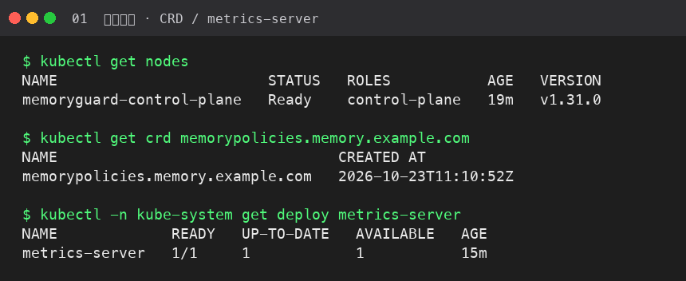
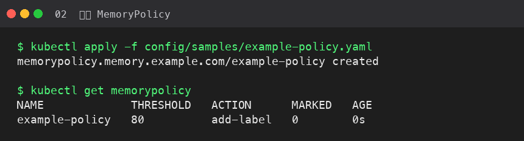
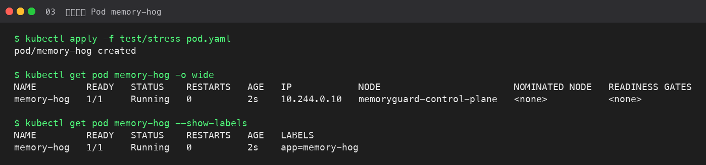
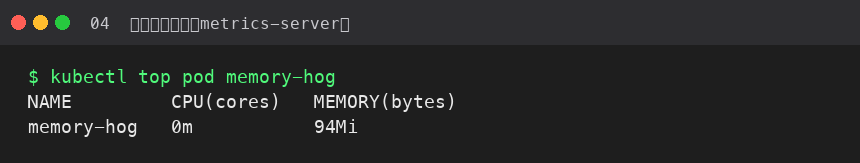
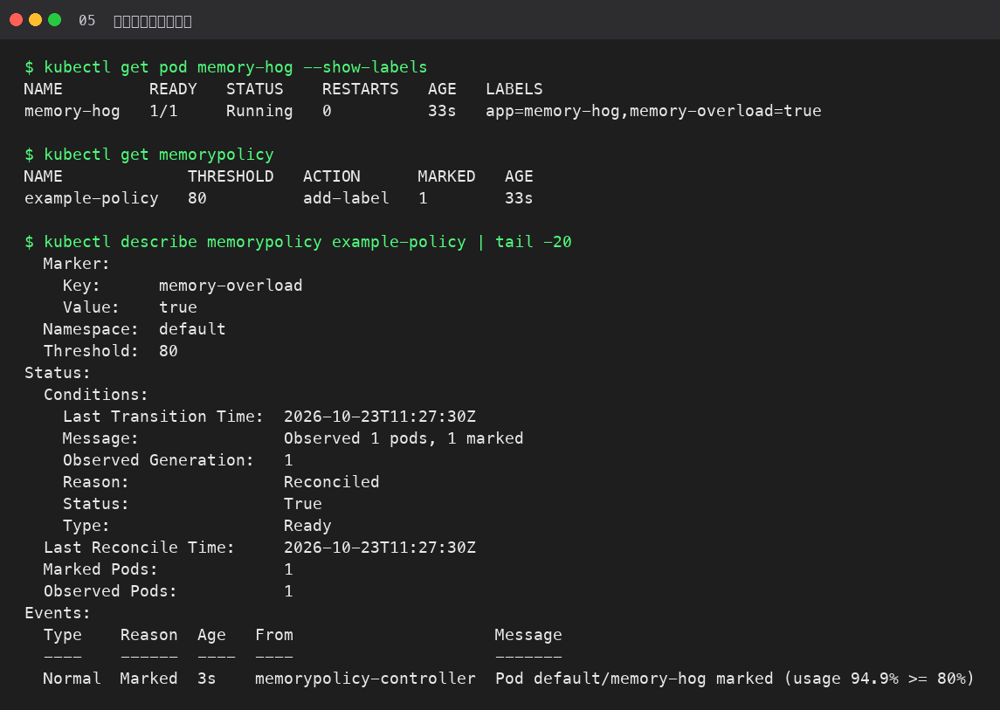
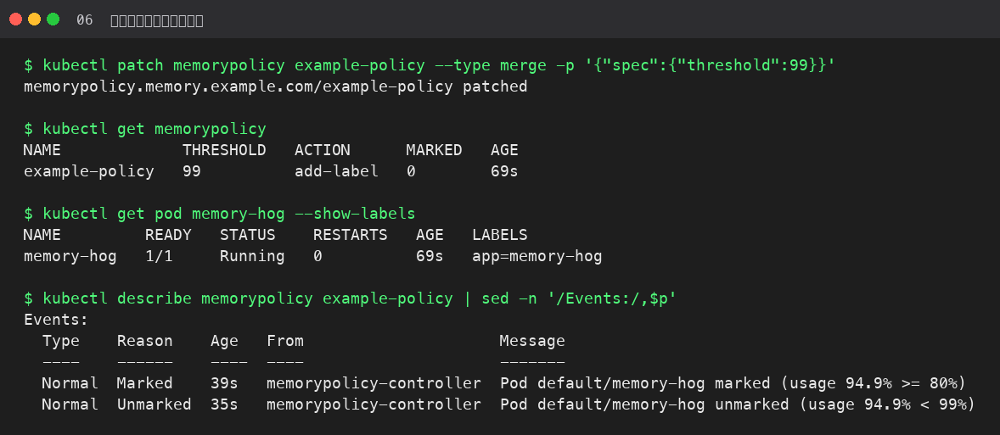
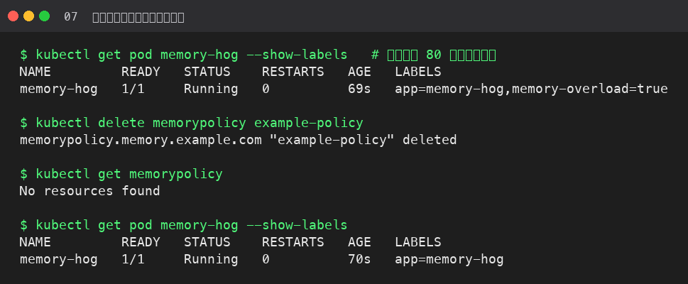

# 测试步骤与截图

在本地 kind 集群 `memoryguard` 上实测。Operator 以 `go run ./cmd/main.go` 对着集群运行，metrics-server 已安装。

压测 Pod：`polinux/stress`，`--vm-bytes 90M`，limit `100Mi`，实测约 **94.9%**。

## 步骤一：确认集群与 CRD

```bash
kubectl get nodes
kubectl get crd memorypolicies.memory.example.com
kubectl -n kube-system get deploy metrics-server
```



## 步骤二：创建 MemoryPolicy

```bash
kubectl apply -f - <<'EOF'
apiVersion: memory.example.com/v1
kind: MemoryPolicy
metadata:
  name: example-policy
spec:
  namespace: "default"
  threshold: 80
  action: "add-label"
  marker:
    key: "memory-overload"
    value: "true"
EOF
kubectl get memorypolicy
```



## 步骤三：创建压测 Pod

```bash
kubectl apply -f test/stress-pod.yaml
kubectl get pod memory-hog --show-labels
kubectl top pod memory-hog
```





## 场景一：超阈值打标

等待调和（约 30s）后：

```bash
kubectl get pod memory-hog --show-labels
kubectl get memorypolicy
kubectl describe memorypolicy example-policy
```

期望：label `memory-overload=true`；Event `marked (usage 94.9% >= 80%)`。



## 场景二：恢复后移除标记

把阈值临时调到 99（用量仍约 94.9%，不再超标）：

```bash
kubectl patch memorypolicy example-policy --type merge -p '{"spec":{"threshold":99}}'
kubectl get pod memory-hog --show-labels
```

期望：`memory-overload` 消失；Event `unmarked (usage 94.9% < 99%)`。



## 场景三：删除策略后清理标记

阈值改回 80 重新打标，再删除策略：

```bash
kubectl patch memorypolicy example-policy --type merge -p '{"spec":{"threshold":80}}'
# 确认已重新打标后：
kubectl delete memorypolicy example-policy
kubectl get pod memory-hog --show-labels
```

期望：策略不存在；Pod 只剩 `app=memory-hog`。


